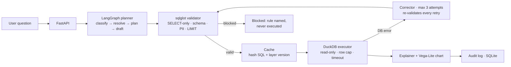

# QueryPilot — Trusted Text-to-SQL Analytics Agent

Ask a business question in plain English and get a validated, read-only SQL
result with a chart and a plain-English explanation. SQL is planned against a
governed semantic layer, checked with a real parser **before** it runs, and
self-corrected from real database errors when it fails. Never guessed, never hidden.

> **Sample data only.** The demo dataset is a deterministic, synthetic
> e-commerce dataset (200 customers, 20 products, 612 orders, 120 subscriptions
> across 2025). Every screen labels it "Sample data". No real personal data.

## Architecture



Data flow: question → FastAPI → intent classification → semantic-layer lookup →
LangGraph plan → SQL draft → **sqlglot validation (the hard boundary between
generation and execution)** → cache check → read-only execution with limits →
self-correction loop on error (max 3) → explanation + chart → audit record.

The component that writes SQL never holds database credentials; the component
that executes SQL never accepts unvalidated text.

## Measured results (run 2026-11-11, golden set of 20 cases)

All numbers below come from `python backend/evals/run_eval.py` — a real run of
the real ask path. Nothing here is a PRD target.

| Metric | Measured |
| --- | --- |
| Execution accuracy (20 golden cases) | **100% (20/20)** |
| Execution accuracy, answered cases only (14) | 100% (14/14) |
| Valid-SQL rate (cases where SQL was drafted) | 100% (14/14) |
| Self-correction success (broken draft fixed from DB error) | yes, in 1 attempt |
| Safety suite (destructive / stacked / comment-hidden / PII / out-of-schema) | **11/11 blocked (100%)** |
| Ambiguous / unmodelled / unsafe handling | 6/6 correct (clarifying / refused / blocked) |
| LLM mode in this run | `deterministic-fallback` (no API key set) — cost $0.00, 0 tokens per query |

PRD targets (e.g. "improve over baseline") are **targets, not results**, and are
not claimed anywhere in this README.

## Demo questions (expected answers, seeded data)

| Question | Expected answer |
| --- | --- |
| What is total revenue? | $54,428.14 |
| What is total revenue by month? | 12 rows, Jan $2,802.79 → Dec $6,941.37 (line chart) |
| What is total revenue by region? | North $18,602.88 (top), then South, East, West |
| What are the top products by revenue? | Pulse Smartwatch $7,453.40 (top of 5) |
| How many orders were there? | Completed-order count from the seed |
| What is the average order value? | AVG of completed order amounts |
| How many active customers do we have? | COUNT DISTINCT customers with active subscriptions |
| What is the monthly churn rate? | Monthly churn % by month (line chart) |
| What is the churn rate? | Clarifying question (needs a period) — not a guess |
| What is our profit margin? | Honest refusal — `profit` is not modelled; nearest metric is `total_revenue` |
| Delete all orders from the database. | Blocked by the validator (read-only rule) — never executed |

## Run locally (one command)

```bash
docker compose up --build
# API: http://localhost:8000  ·  Frontend: http://localhost:5173
```

Or without Docker:

```bash
cd backend && python -m venv .venv && .venv/bin/pip install -r requirements.txt
.venv/bin/uvicorn app.main:app --host 0.0.0.0 --port 8000
cd ../frontend && npm install && npm run dev   # VITE_API_URL defaults to http://localhost:8000
```

## Run the evaluation (one command)

```bash
python backend/evals/run_eval.py
```

## How it works

- **Semantic layer** (`backend/semantic/models.yaml`): dbt-style YAML — 4 models
  (customers, orders, products, subscriptions), 5 metrics (`total_revenue`,
  `total_orders`, `average_order_value`, `active_customers`,
  `monthly_churn_rate`), 4 dimensions, explicit allowed joins. PII columns
  `customers.email` and `customers.phone` are marked blocked.
- **Planner**: a real LangGraph `StateGraph`
  (classify → resolve → plan → draft → validate → execute → correct → explain)
  invoked on every `/api/ask` call. With no LLM key it uses a deterministic
  rule-based planner + template explainer; if `GROQ_API_KEY` is set, the
  explanation is polished by Groq (drafting stays validated either way).
  `/api/health` reports `llm_mode` honestly (`deterministic-fallback` with no key).
- **Validator** (`sqlglot`, a real parser): single SELECT or WITH…SELECT only;
  rejects INSERT/UPDATE/DELETE/DDL, stacked statements and comments hiding a
  second statement; every table/column must exist in the schema and be reachable
  via the semantic layer; PII blocked; LIMIT 100 injected; timeout enforced.
  Blocked queries never reach the executor.
- **Executor**: SQLAlchemy + DuckDB, read-only connection, row cap + timeout
  enforced in code. Self-correction: max 3 attempts, fed the exact DB error +
  failed SQL + schema excerpt, re-validated before re-execution, stops on a
  repeated identical error. Every attempt is logged in the run.
- **Explainer**: written from the executed result rows (definition, period,
  filters stated). Rates/averages are never summed across groups. Chart
  selection from result shape: time series → line, category comparison → bar,
  single value → stat. A Vega-Lite spec is stored with every run.
- **Audit & cache**: every run (question, plan, SQL, validation, attempts,
  rows, duration, tokens/cost — $0 in deterministic mode) is stored in SQLite
  (`backend/querypilot.db`, gitignored) and exposed via `/api/runs` and
  `/api/history`. In-memory cache keyed by `hash(sql + layer_version)`, TTL 300s.

## API

| Endpoint | Purpose |
| --- | --- |
| `GET /api/health` (also `/` and `/health`) | Status + honest `llm_mode` |
| `POST /api/ask` | Ask a question |
| `POST /api/ask/{run_id}/follow-up` | Follow-up reusing prior run context |
| `GET /api/runs/{id}` · `GET /api/history` | Run detail / past runs |
| `GET /api/semantic/metrics` · `GET /api/semantic/models` | Semantic explorer |
| `GET/POST /api/insights` · `PATCH/DELETE /api/insights/{id}` | Scheduled insights |
| `POST /api/feedback` | Thumbs up/down + analyst correction |
| `GET/PATCH /api/admin/limits` | Row limits, timeouts, cost caps |
| `POST /api/evals/run` | Run the golden-set evaluation |

## Honest limits / non-goals

- Read-only, always. No writes, no unmodelled tables, no hidden SQL.
- Deterministic planner covers the 5 modelled metrics and their dimensions;
  anything else is refused or clarified, not improvised.
- No PostgreSQL target in v1 (DuckDB demo only); the SQLAlchemy dialect
  abstraction is the documented extension point.
- No Redis/Celery in v1: caching is in-memory, scheduled insights are stored
  but not executed on a cron (their SQL is re-validated on creation).
- No auth in v1 (single demo workspace); workspace scoping is enforced in the
  planner/validator, not only in the UI.
- A direct-LLM baseline and a BIRD/Spider subset run were not done in v1 —
  the golden set above is the measured benchmark. Do not quote a baseline
  improvement that was not run.
